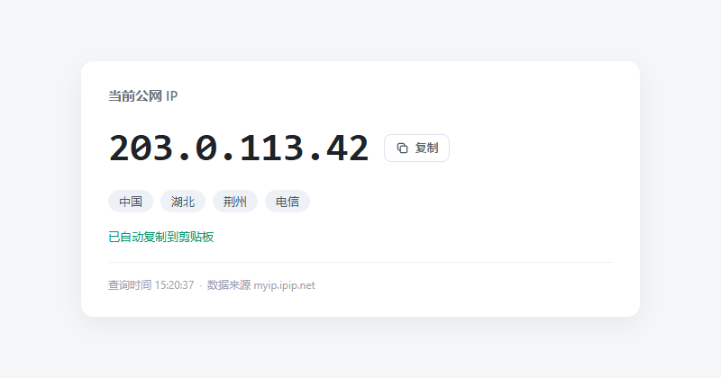

# 公网 IP（uTools 插件）

进入插件后自动查询并复制当前公网 IP，同时展示 IP 归属地。



## 使用

在 uTools 中输入以下任一关键词进入：

- `公网IP`
- `我的IP`
- `ip`
- `myip`
- `查IP`

每次进入查询一次，查询成功后自动将 IP 写入剪贴板；也可点击 IP 或右侧「复制」按钮再次复制。

查询接口：<https://myip.ipip.net/json>

## 开发

```bash
npm install
npm run dev
```

在 uTools 中打开「插件应用开发」→「新建项目」，选择 `public/plugin.json`。

## 构建

```bash
npm run build
```

构建产物在 `dist/`，可作为插件应用目录加载或打包。

## 上线资料

| 资料 | 文件 |
| --- | --- |
| 插件图标（256×256 PNG，圆角透明背景） | `public/logo.png` |
| 图标矢量源文件 | `design/icon.svg` |
| 图标尺寸预览 | `design/icon-preview.png` |
| 浅色模式截图（800×420） | `docs/screenshot-light.png` |
| 深色模式截图（800×420） | `docs/screenshot-dark.png` |
| 商店介绍、更新日志、隐私说明 | `docs/store-listing.md` |

在 uTools「开发者工具 → 发布版本」中填写版本说明、应用介绍，并上传上述两张截图。

## 实现说明

- 请求在 `public/preload.js` 中通过 `node:https` 发起，避免插件页面的跨域限制。
- 请求超时时间为 8 秒，并校验接口返回的 `ret` 与 `data.ip`。
- 归属地数组中的空项会被过滤，只展示有效地区与运营商信息。

## 隐私说明

- 插件仅向 `https://myip.ipip.net/json` 发起请求以获取公网 IP 与归属地。
- 不收集、不存储、不上传任何用户数据，无账号体系、埋点统计和广告。
- 插件只向剪贴板写入查询到的 IP，不读取剪贴板内容。
